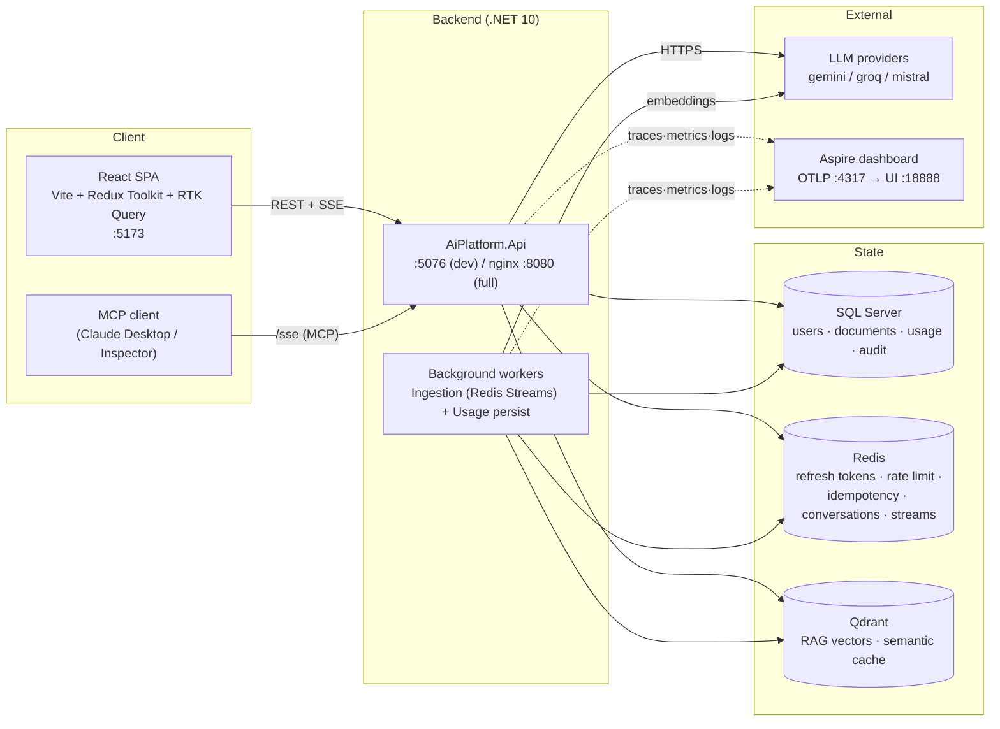
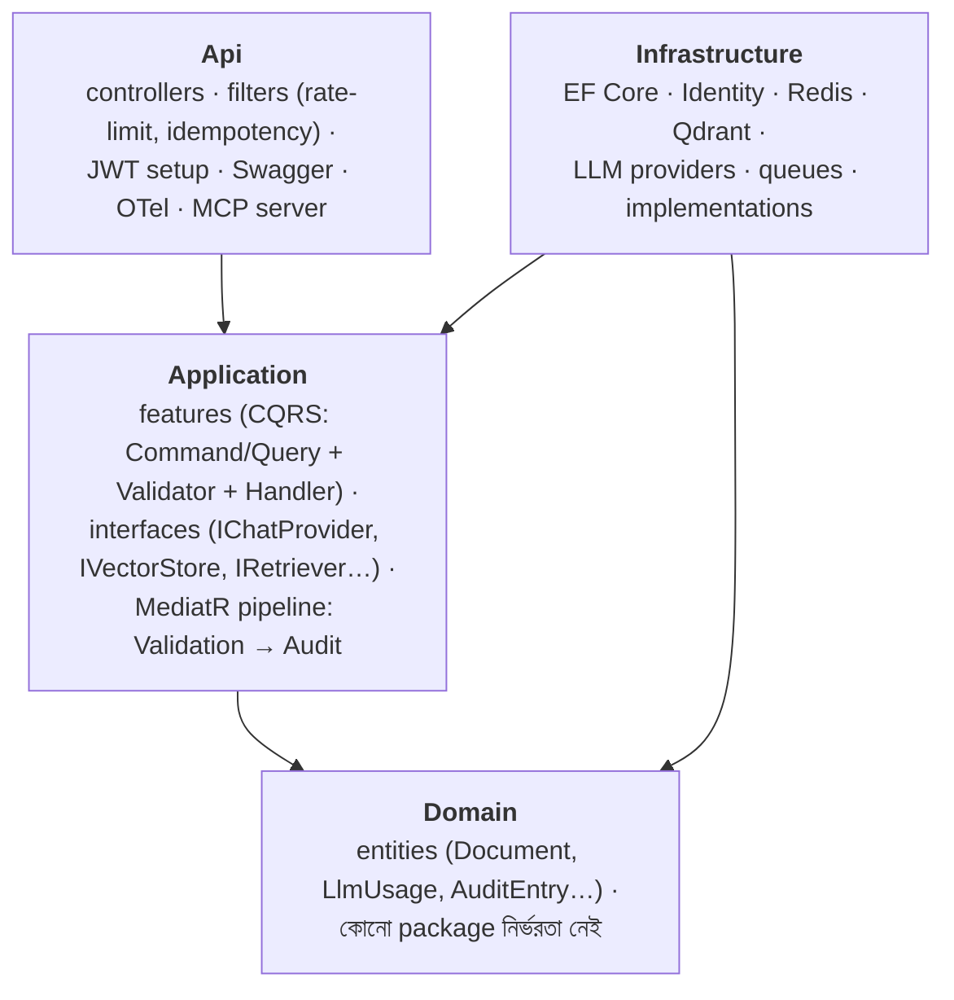
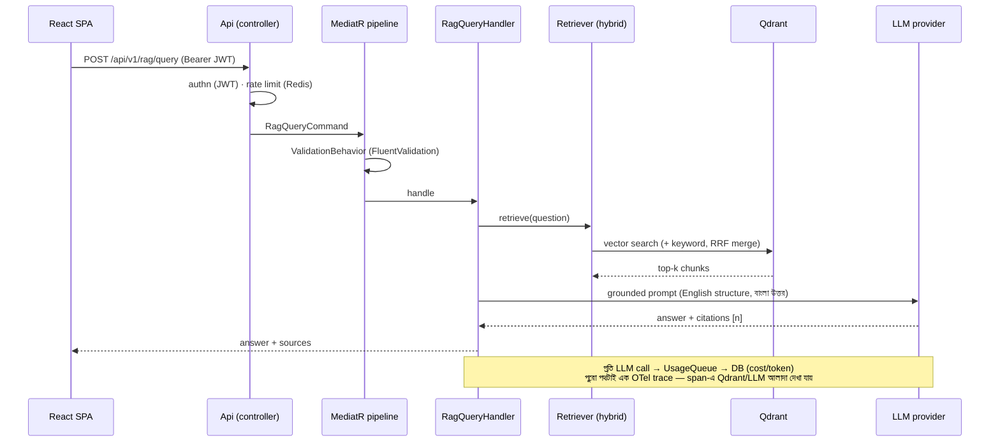
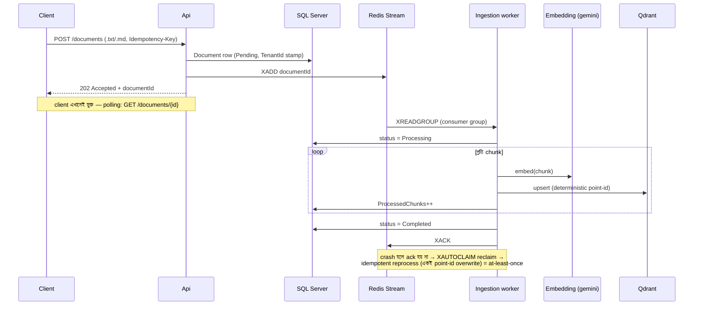

# Architecture (বাংলা)

> এক পাতায় পুরো সিস্টেম — স্তর, নির্ভরতার দিক, আর দুটো গুরুত্বপূর্ণ request-এর যাত্রা।
> Diagram গুলো mermaid — GitHub-এ নিজে থেকেই রেন্ডার হয়।

---

## ১. Big picture — কে কার সাথে কথা বলে

- **dev মোড:** `docker compose up -d` → শুধু state/external container; API আর frontend তুমি চালাও।
- **full মোড:** `docker compose --profile full up -d --build` → + api×2 + nginx LB (:8080)। API stateless — সব state SQL/Redis/Qdrant-এ, তাই যেকোনো replica যেকোনো request নিতে পারে।

---

## ২. Clean Architecture — নির্ভরতার দিক

নিয়ম দুটোই: **ভেতরের স্তর বাইরের কাউকে চেনে না** (Domain কাউকে না, Application শুধু Domain-কে), আর **interface Application-এ, implementation Infrastructure-এ** — তাই hosted LLM → local LLM বদলানো মানে শুধু নতুন implementation, কোনো handler বদলায় না (north star)।

---

## ৩. Request flow — RAG query (synchronous পথ)

---

## ৪. Request flow — document upload → ingestion (asynchronous পথ)

---

## ৫. Auth — token দুটো কোথায় থাকে

| Token | কোথায় | আয়ু | কেন |
|---|---|---|---|
| **Access (JWT)** | frontend মেমোরি (Redux) — localStorage **নয়** | ১৫ মিনিট | XSS চুরি করতে পারে না; ছোট আয়ু = ফাঁস হলেও ক্ষতি সীমিত |
| **Refresh** | httpOnly cookie (`Path=/api/v1/auth`) | ৭ দিন, প্রতি ব্যবহারে rotate | JS পড়তেই পারে না; reuse ধরা পড়লে পুরো family বাতিল |

Page reload → মেমোরি খালি → `AppBootstrap` চুপচাপ `/auth/refresh` (cookie সহ) → নতুন access token। এই chain E2E টেস্টে পাহারা দেওয়া (`frontend/e2e/auth.spec.ts`)।

---

## ৬. Test pyramid

| স্তর | কোথায় | কতগুলো | কী প্রমাণ করে |
|---|---|---|---|
| Unit | `backend/tests/Application.Tests` | 75 | handler/লজিক, সব dependency নকল |
| Integration | `backend/tests/Api.IntegrationTests` | 16 | আসল SQL Server+Redis container-এ পুরো HTTP পথ — query filter, tenant isolation, idempotency |
| E2E | `frontend/e2e` | 3 | আসল ব্রাউজার — CORS, refresh cookie, redirect |

CI (`.github/workflows/ci.yml`): প্রতি push-এ প্রথম দুই স্তর + frontend lint/build। বিস্তারিত: [ci-guide.md](ci-guide.md)।
